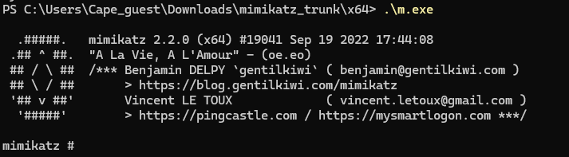
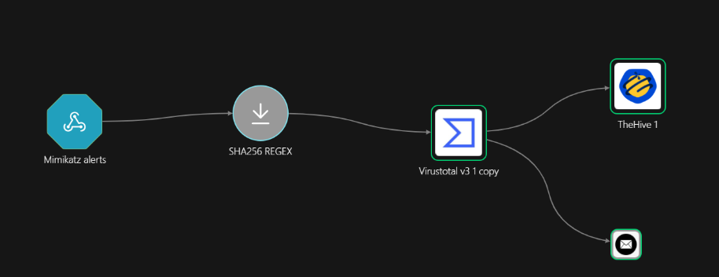
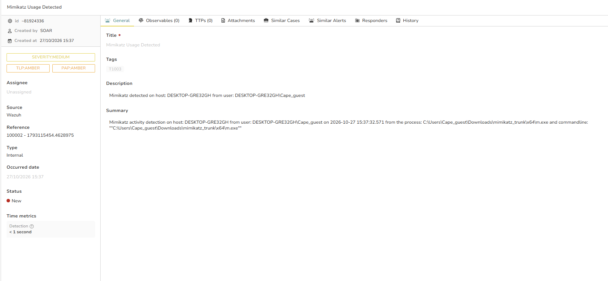

# Mimikatz Credential Dumping — Detection & Response

## Overview

Mimikatz is a credential-dumping tool used to extract plaintext passwords, hashes and Kerberos tickets from LSASS memory. This case detects its execution on a Windows endpoint and drives an enrichment pipeline that records a case in TheHive.

- Technique: MITRE ATT&CK **T1003** (OS Credential Dumping)
- Rule ID: **100002** (level 15)
- Workflow: Pipeline A — enrich → case → notify

## Detection Rule

Detection is by Sysmon original-file-name rather than the on-disk name, so a renamed binary (`m.exe`, `x.exe`) is still caught — the original name stays embedded in the PE metadata.

```xml
<rule id="100002" level="15">
  <if_group>sysmon_event1</if_group>
  <field name="win.eventdata.originalFileName" type="pcre2">(?i)mimikatz\.exe</field>
  <description>Mimikatz Usage Detected</description>
  <mitre>
    <id>T1003</id>
  </mitre>
</rule>
```

## Triggering the Alert

Run Mimikatz on the Windows endpoint:

```powershell
.\mimikatz.exe "privilege::debug" "sekurlsa::logonpasswords" exit
```



## SOAR Workflow (Shuffle) — Pipeline A

Trigger: rule 100002 forwarded to a Shuffle webhook via an `<integration>` block in the manager `ossec.conf` (`<rule_id>100002</rule_id>`, `<alert_format>json</alert_format>`).

Flow: **webhook → extract SHA256 → VirusTotal file report → create TheHive alert → email the analyst.**

- The **Webhook** node receives the full alert JSON (`$exec`).
- A **Regex** node extracts the clean hash with the capture group `SHA256=([A-Fa-f0-9]{64})` from `win.eventdata.hashes` (the capture group, not the full match, so no `SHA256=` prefix reaches VirusTotal).
- **VirusTotal — Get a hash report** with `Id` set to the extracted hash returns the detection ratio and malware classification.
- **TheHive — Create alert** uses a unique `sourceRef` derived from the Wazuh alert id. The Windows command line is escaped with Liquid filters (backslashes first, then quotes) so the JSON body stays valid.
- **Email** notifies the analyst with the host, hash and VirusTotal verdict.


## Result

The enriched alert created by the pipeline:


