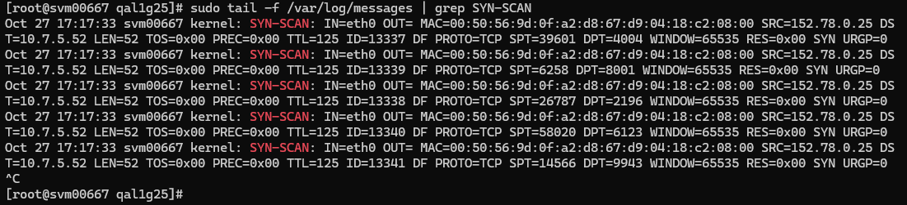
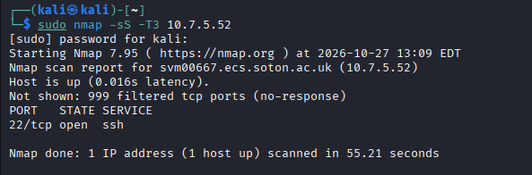
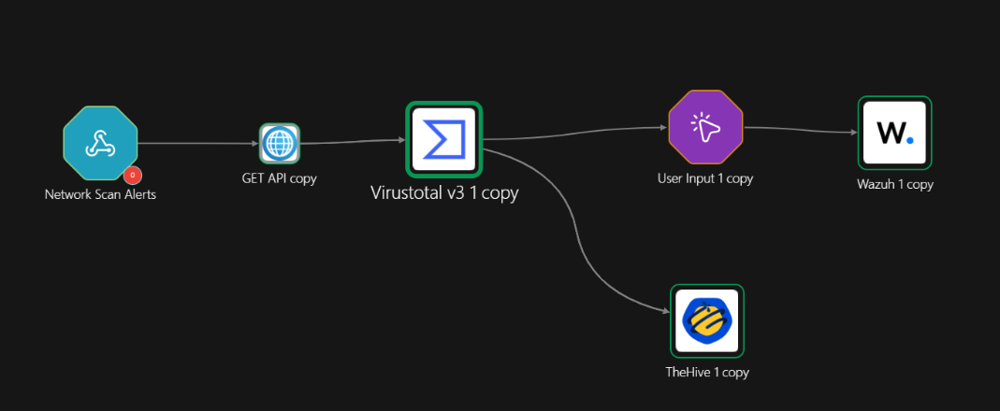
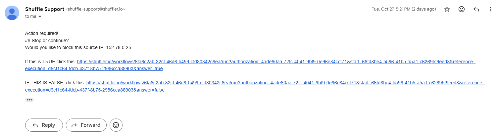
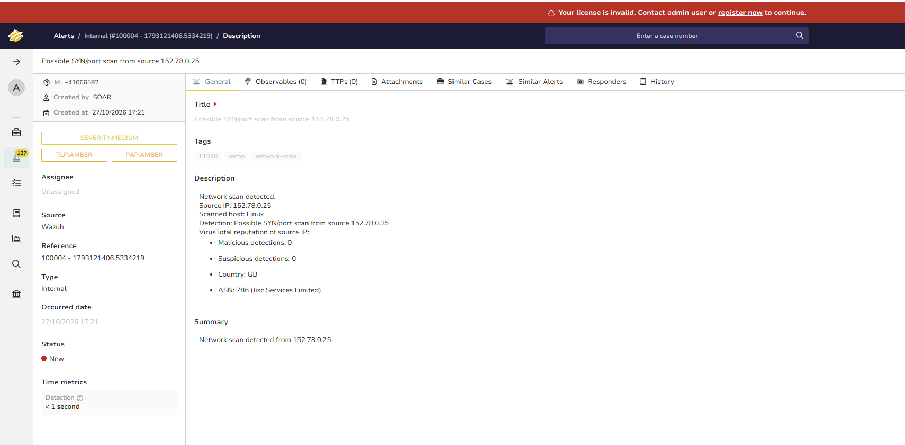

# Network Scan / Recon — Detection & Response

## Overview

Port scanning and host sweeps are reconnaissance — an attacker mapping open services or live hosts before an attack. Wazuh has no native packet visibility, so this case adds iptables logging as a new log source and detects scanning by frequency.

- Technique: MITRE ATT&CK **T1046** (Network Service Discovery)
- Rule IDs: **100003–100006**
- Workflow: Workflow C — enrich → case → human approval → block

## Log Source — iptables Logging

Dedicated LOG rules on the Linux endpoint tag SYN packets and ICMP probes with a prefix, and those lines are shipped to Wazuh via a localfile reading `/var/log/messages`:

```bash
sudo iptables -I INPUT 1 -p tcp --syn -j LOG --log-prefix "SYN-SCAN: "
sudo iptables -I INPUT 2 -p icmp -j LOG --log-prefix "ICMP-PROBE: "
```

> iptables rules do not survive a reboot — persist them with `sudo iptables-save | sudo tee /etc/sysconfig/iptables` (RHEL) or `sudo netfilter-persistent save` (Debian), or the rules vanish and detection silently stops.



## Detection Rule

A low-level base rule matches a single packet silently (`no_log`, feeding only the counter); a frequency child fires when many packets arrive from one source in a short window — to many ports (a port scan) or many hosts (a sweep). The `ignore` attribute collapses a whole scan burst into one alert.

```xml
<group name="network_scan,recon,">

  <rule id="100003" level="1">
    <if_sid>4100</if_sid>
    <match>SYN-SCAN:</match>
    <description>Firewall: single SYN packet logged</description>
    <options>no_log</options>
  </rule>

  <rule id="100004" level="10" frequency="15" timeframe="10" ignore="300">
    <if_matched_sid>100003</if_matched_sid>
    <same_srcip />
    <different_dstport />
    <description>Possible SYN/port scan from source $(srcip)</description>
    <mitre><id>T1046</id></mitre>
    <group>recon,attack,network_scan,</group>
  </rule>

  <rule id="100005" level="1">
    <if_sid>4100</if_sid>
    <match>ICMP-PROBE:</match>
    <description>Firewall: single ICMP packet logged</description>
    <options>no_log</options>
  </rule>

  <rule id="100006" level="10" frequency="8" timeframe="10" ignore="300">
    <if_matched_sid>100005</if_matched_sid>
    <same_srcip />
    <different_dstip />
    <description>Possible ICMP host sweep from source $(srcip)</description>
    <mitre><id>T1046</id></mitre>
    <group>recon,attack,network_scan,</group>
  </rule>

</group>
```

The `same_srcip` / `different_dstport` / `different_dstip` fields distinguish a scan (one source hitting many targets fast) from normal traffic. `ignore="300"` stops the frequency rule re-firing throughout a long scan, which otherwise produces a flood of alerts and emails.

## Triggering the Alert

A moderate SYN scan from the attacker machine:

```bash
sudo nmap -sS -T3 10.7.5.52
```

> Keep it moderate — `nmap -p- -T4` overloads the agent event queue (rule 203) and drops the events the rule needs.



## SOAR Workflow (Shuffle) — Workflow C

Trigger: rules 100004/100006 forwarded to a Shuffle webhook (`<rule_id>100004,100006</rule_id>`).

Flow: **webhook → VirusTotal IP report → create TheHive alert + ask the analyst → block the source IP on approval.** No Regex node is needed — the source IP is already a clean field.

- **VirusTotal — Get an IP report** with `Id` set to `data.srcip` returns malicious votes, country and ASN.
- **TheHive — Create alert** records the source IP, scanned host (`agent.name`), scan type (`rule.description`) and the VirusTotal verdict (a parallel branch, so the case is always created regardless of the block decision).
- **User Input** emails the analyst a block/allow decision with two one-click links (see below) and pauses the workflow until they respond.
- **Wazuh — Run command** calls active response (`firewall-drop`) to add an iptables DROP for the source IP on the endpoint, only when the analyst approves.



### The analyst decision email (User Input node)

The User Input node sends an email like "Would you like to block this source IP: `<srcip>`?" containing two links — one that resumes the workflow with `answer=true`, the other with `answer=false`. Clicking **TRUE** continues the branch to the Wazuh block; **FALSE** ends it without action. This is the human-in-the-loop gate: the destructive block never happens without a deliberate click.



Active response is defined on the manager (the `firewall-drop` command plus an `<active-response>` block with a finite `<timeout>`), with a `<white_list>` for trusted admin/VPN ranges so a scan from a legitimate source can't lock you out. The Wazuh "Run command" node authenticates to the API on port 55000 with a short-lived JWT fetched at run time.

## Result


