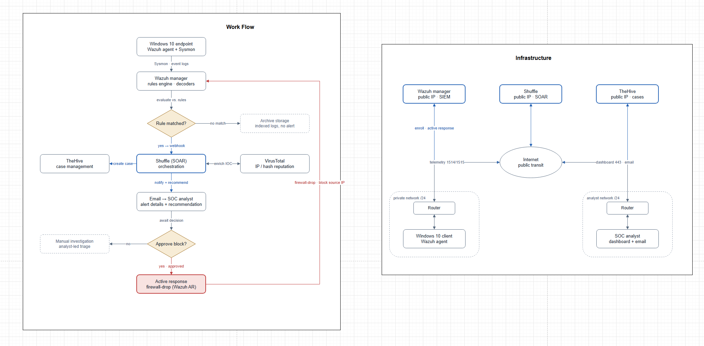

# SOC Automation Lab

A home-lab Security Operations Center built from open-source tools: Wazuh (SIEM/XDR), Shuffle (SOAR), TheHive (case management) and VirusTotal (threat intel). When an attack runs against a monitored endpoint, Wazuh raises an alert, Shuffle enriches it with VirusTotal, opens a case in TheHive and emails the analyst. For network attacks, the analyst can approve a firewall block on the attacking host from that email.

The project covers the whole alert lifecycle on the blue-team side, from writing detection rules to automating the response, with an analyst approving every block.

## Architecture



Part of the lab runs in the cloud and part on a private network. Wazuh and Shuffle have public addresses, while TheHive and the endpoints sit behind NAT, and connecting the two sides took most of the integration work.

| Host | Role | Location |
| --- | --- | --- |
| Wazuh manager | SIEM/XDR, rules engine, indexer, dashboard | Azure VM (public IP) |
| Windows 11 | Monitored endpoint (Wazuh agent + Sysmon) | Local VMware |
| Linux endpoint | Monitored endpoint (iptables logging, SSH target) | Lab network |
| Shuffle | SOAR orchestration (one workflow per detection) | Cloud (shuffler.io) |
| TheHive | Case management | Local VM, exposed via ngrok |
| VirusTotal | IP, domain and file-hash enrichment | SaaS |

Data flow: endpoint telemetry → Wazuh agent → manager (decoders + rules) → alert → Shuffle webhook → VirusTotal enrichment → TheHive case + analyst email → (on approval) Wazuh active response blocks the source IP.

## Detection use cases

Each folder has a write-up, the Wazuh rule, the Shuffle integration block, and screenshots of the attack, the workflow and the resulting alert.

| Use case | MITRE ATT&CK | Rule IDs | Response |
| --- | --- | --- | --- |
| [Mimikatz credential dumping](Mimikatz_Usage_detection/Mimikatz_detection.md) | T1003 | 100002 | Hash → VirusTotal → TheHive alert → email |
| [Network scan / recon](Network_scan_detection/Network_scan_detection.md) | T1046 | 100003–100006 | IP → VirusTotal → TheHive alert + analyst approval → `firewall-drop` |
| [SSH brute force](SSH_bruteforce_detection/SSH_bruteforce_detection.md) | T1110 | 5712, 5763 (built-in) | IP → VirusTotal → analyst approval → `firewall-drop` |
| [WMI abuse](WMI_abuse_detection/WMI_abuse_detection.md) | T1047 | 100007–100008 | Hash → VirusTotal → TheHive alert → email |
| [Suspicious remote download](Remote_Download_detection/Suspicious_download_detection.md) | T1105 | 100009–100011 | Domain → VirusTotal → TheHive alert → email |

## Repository structure

```
.
├── README.md
├── SOC_Automation_Proj_Diagram.png       # workflow + infrastructure diagram
├── Wazuh-Install-Instructions.md         # Wazuh server install
├── wazuh_agent_setup.md                  # Windows/Linux agents + Sysmon
├── TheHive-Install-Instructions.md       # TheHive 5 + ngrok bridge
├── images/                               # screenshots for the setup guides
│
├── Mimikatz_Usage_detection/
├── Network_scan_detection/
├── SSH_bruteforce_detection/
├── WMI_abuse_detection/
└── Remote_Download_detection/
    ├── <use-case>.md                     # overview, rule, test, SOAR workflow, result
    ├── config/
    │   ├── <Name>_custom_rule.xml        # Wazuh custom rule(s)
    │   └── Shuffle_integration_0X_ossec.conf  # <integration> block for the webhook
    └── images/                           # attack, workflow and alert screenshots
```

SSH brute force uses Wazuh's built-in rules, so its `config/` folder holds only the integration block.

## Setup guides

| Document | What it covers |
| --- | --- |
| [Wazuh-Install-Instructions.md](Wazuh-Install-Instructions.md) | Installing the Wazuh 4.7 all-in-one stack and initial configuration |
| [wazuh_agent_setup.md](wazuh_agent_setup.md) | Enrolling Windows and Linux agents, plus Sysmon telemetry |
| [TheHive-Install-Instructions.md](TheHive-Install-Instructions.md) | TheHive 5 with Cassandra/Elasticsearch, tuning, and the ngrok bridge |

## Build order

1. Deploy the Wazuh server ([guide](Wazuh-Install-Instructions.md)).
2. Enroll the endpoints as agents and enable Sysmon telemetry ([guide](wazuh_agent_setup.md)).
3. Deploy TheHive and expose it to cloud Shuffle via ngrok ([guide](TheHive-Install-Instructions.md)).
4. For each use case:
   - add the rules from `config/*_custom_rule.xml` to `/var/ossec/etc/rules/local_rules.xml` on the manager;
   - add the `config/Shuffle_integration_0X_ossec.conf` block inside `<ossec_config>` in `/var/ossec/etc/ossec.conf`, replacing the `hook_url` with your own Shuffle webhook;
   - restart the manager (`sudo systemctl restart wazuh-manager`), build the Shuffle workflow described in the write-up, and trigger the test attack.

## Design notes

- The Mimikatz rule matches the Sysmon `originalFileName` field, which comes from the binary's PE metadata, so renaming `mimikatz.exe` doesn't avoid it.
- Wazuh can't see network packets on its own. The scan detection adds iptables LOG rules on the Linux endpoint and ships those log lines to Wazuh.
- The built-in ruleset misses PowerShell and `bitsadmin` downloads and non-PE payloads, so the download rules cover those cases.
- Workflows trigger only on aggregated frequency rules (for example 5712 rather than the per-attempt 5710), and the scan rules use `ignore` windows. One attack therefore produces one alert and one email.
- `firewall-drop` runs only after the analyst clicks approve in the email. Trusted sources are whitelisted, and every block has a timeout.

## Testing reference

Each detection was validated by running the attack it targets: `nmap -sS` for scanning, `hydra` for SSH brute force, `Invoke-WmiMethod` for WMI execution, `Invoke-WebRequest` for remote download, and Mimikatz for credential dumping:
https://github.com/gentilkiwi/mimikatz/releases/tag/2.2.0-20220919

> Mimikatz and the other attack tools were run only against isolated lab endpoints.

## Author

Quoc Anh Luu, MSc Cyber Security, University of Southampton.
