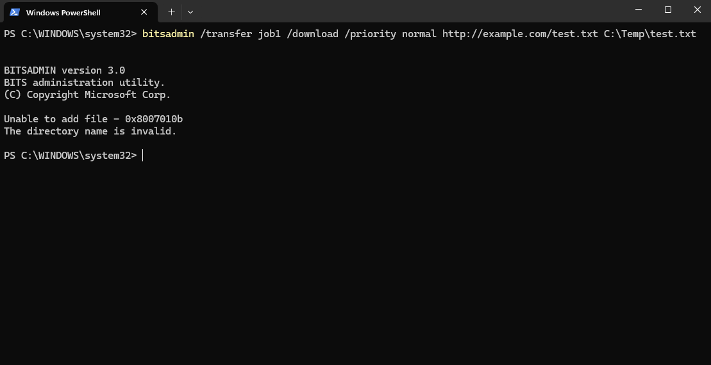
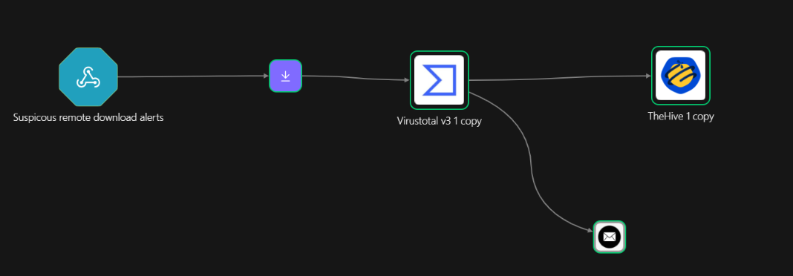
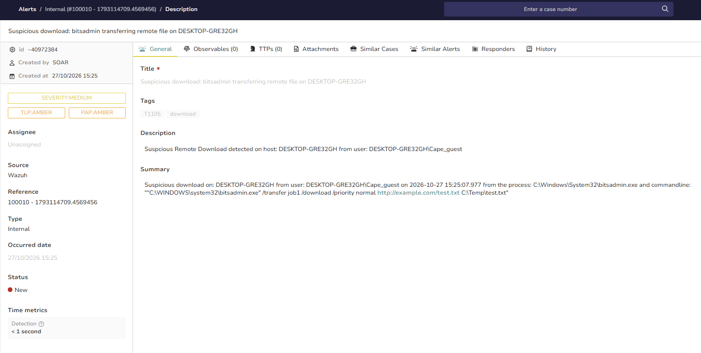

# Suspicious Download — Detection & Response

## Overview

Attackers frequently pull payloads from a remote server using living-off-the-land binaries (PowerShell, `certutil`, `bitsadmin`). This case detects download behaviour the built-in ruleset misses and enriches the downloaded domain.

- Technique: MITRE ATT&CK **T1105** (Ingress Tool Transfer)
- Rule IDs: **100009–100011**
- Workflow: Workflow E — enrich → case → notify

## Detection Rule

The built-in rules cover some LOLBin downloads (92074 for curl/wget fetching a PE, 92075 for `certutil -urlcache` fetching a PE), but miss PowerShell cmdlets, `bitsadmin`, and non-PE payload extensions. Three rules close those gaps, all children of `sysmon_event1`.

```xml
<group name="suspicious_download,">

  <!-- PowerShell downloading remote content (gap: no built-in rule) -->
  <rule id="100009" level="12">
    <if_group>sysmon_event1</if_group>
    <field name="win.eventdata.image" type="pcre2">(?i)(powershell|pwsh)\.exe$</field>
    <field name="win.eventdata.commandLine" type="pcre2">(?i)(Invoke-WebRequest|\biwr\b|DownloadFile|DownloadString|DownloadData|Start-BitsTransfer|Net\.WebClient)</field>
    <description>Suspicious download: PowerShell downloading remote content on $(win.system.computer)</description>
    <mitre><id>T1105</id><id>T1059.001</id></mitre>
  </rule>

  <!-- bitsadmin transferring a file (gap) -->
  <rule id="100010" level="12">
    <if_group>sysmon_event1</if_group>
    <field name="win.eventdata.originalFileName" type="pcre2">(?i)bitsadmin\.exe</field>
    <field name="win.eventdata.commandLine" type="pcre2">(?i)/transfer|/addfile</field>
    <description>Suspicious download: bitsadmin transferring remote file on $(win.system.computer)</description>
    <mitre><id>T1105</id><id>T1197</id></mitre>
  </rule>

  <!-- certutil/curl/wget fetching a NON-PE file (.exe/.dll already handled by 92074/92075) -->
  <rule id="100011" level="10">
    <if_group>sysmon_event1</if_group>
    <field name="win.eventdata.originalFileName" type="pcre2">(?i)(certutil|curl|wget)\.exe</field>
    <field name="win.eventdata.commandLine" type="pcre2">(?i)(-urlcache|-o |-out|-outfile).+(\.ps1|\.bat|\.scr|\.vbs|\.zip|\.dat|\.txt)</field>
    <description>Suspicious download: $(win.eventdata.originalFileName) fetching non-PE file (possible evasion) on $(win.system.computer)</description>
    <mitre><id>T1105</id></mitre>
  </rule>

</group>
```

## Triggering the Alert

A PowerShell download triggers rule 100009 — the most reliable test, since `certutil` is often blocked by Windows Defender/ASR:

```powershell
Invoke-WebRequest -Uri "http://example.com/test.txt" -OutFile C:\Temp\test.txt
```



## SOAR Workflow (Shuffle) — Workflow E

Trigger: rules 100009–100011 forwarded to a Shuffle webhook (`<rule_id>100009,100010,100011</rule_id>`).

Flow: **webhook → extract URL/domain → VirusTotal domain report → create TheHive alert → email.**

- A **Regex** node on `win.eventdata.commandLine` with `(https?://([^/\s:'"]+)[^\s'"]*)` returns the full URL (`group_1`) and the domain (`group_2`). Reference the element directly (`.#`) to pass a clean string rather than a list.
- **VirusTotal — Get a domain report** with `Id` set to the domain returns the domain's reputation.
- **TheHive — Create alert** records host, downloader image, the URL and domain, and the VirusTotal verdict.
- **Email** notifies the analyst.



## Result


