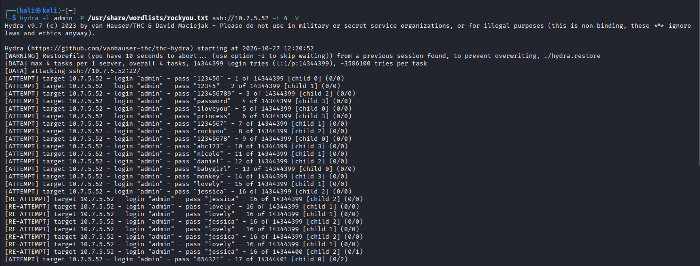
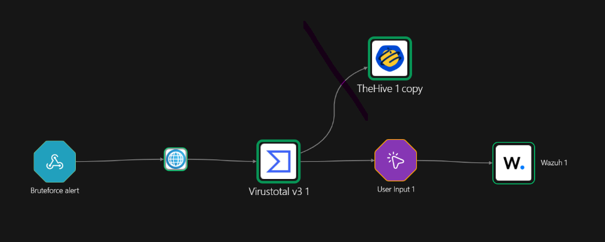
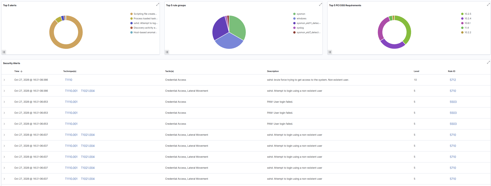

# SSH Brute Force — Detection & Response

## Overview

Repeated failed SSH logins indicate an attacker guessing credentials. This case uses Wazuh's built-in SSH rules and drives an active-response pipeline that blocks the source IP after analyst approval — the only case in the lab with a destructive action, deliberately gated by a human.

- Technique: MITRE ATT&CK **T1110** (Brute Force)
- Rule IDs: built-in **5712** (optionally 5763) — see the note below
- Workflow: Pipeline B — enrich → human approval → block

## Detection Rules (built-in)

No custom rule is needed — Wazuh's shipped ruleset already covers SSH brute force:

- **5710** — a single failed login with an invalid/non-existent user (per-event).
- **5712** — "sshd: brute force trying to get access to the system": a frequency rule that fires once when many failures occur in a short window.
- **5763** — a breakin/brute-force escalation in the same family.

> **Forward only 5712 (optionally 5763) to the workflow — never 5710.** Rule 5710 fires on every single failed attempt, so forwarding it sends one webhook and one email per password tried, which floods the analyst. Rule 5712 fires once per brute-force burst, which is what the pipeline should act on.

## Triggering the Alert

A hydra brute force from the attacker machine against the Linux endpoint:

```bash
hydra -l admin -P pwlist.txt ssh://10.7.5.52 -t 4 -V
```



## SOAR Workflow (Shuffle) — Pipeline B

Trigger: rule 5712 forwarded to a Shuffle webhook (`<rule_id>5712</rule_id>`).

Flow: **webhook → enrich source IP → ask the analyst → block on approval.**

- **VirusTotal — Get an IP report** on `data.srcip` returns the reputation of the attacking address.
- **User Input** emails the analyst a block/allow decision and pauses the workflow — the human-in-the-loop gate before any destructive action.
- **Wazuh — Run command** calls active response (`firewall-drop`) to add an iptables DROP for the IP on the endpoint, only on approval.




### The analyst decision email (User Input node)

The User Input node sends an email like "Would you like to block this source IP: `<srcip>`?" containing two links — one that resumes the workflow with `answer=true`, the other with `answer=false`. Clicking **TRUE** continues the branch to the Wazuh block; **FALSE** ends it without action. This is the human-in-the-loop gate: the block never happens without a deliberate click.


Active response is defined on the manager (the `firewall-drop` command plus an `<active-response>` block with a finite `<timeout>`), with a `<white_list>` for trusted admin ranges so the response never blocks your own access.

The Wazuh API (port 55000) authentication uses a short-lived JWT fetched at run time (it expires after 15 minutes):

```bash
curl -u <user>:<pass> -k -X GET "https://<public-ip>:55000/security/user/authenticate?raw=true"
```

## Result



## Lesson

Forwarding the per-event rule 5710 to this pipeline caused an email flood — one message per login attempt. The fix is to trigger the pipeline only on the aggregated rule 5712, which fires once per attack. The same principle applies to every notifying or acting workflow: forward aggregated, high-level rules, not per-event ones.
