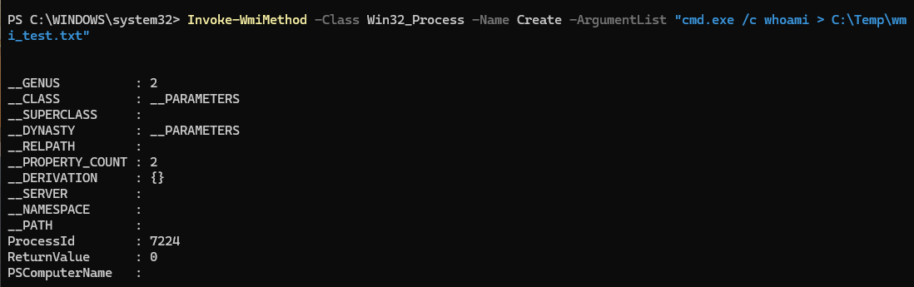
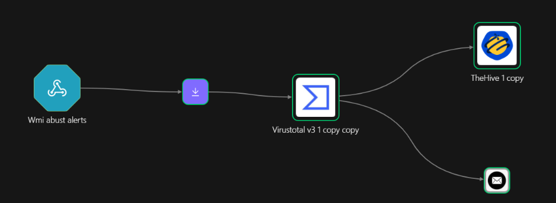
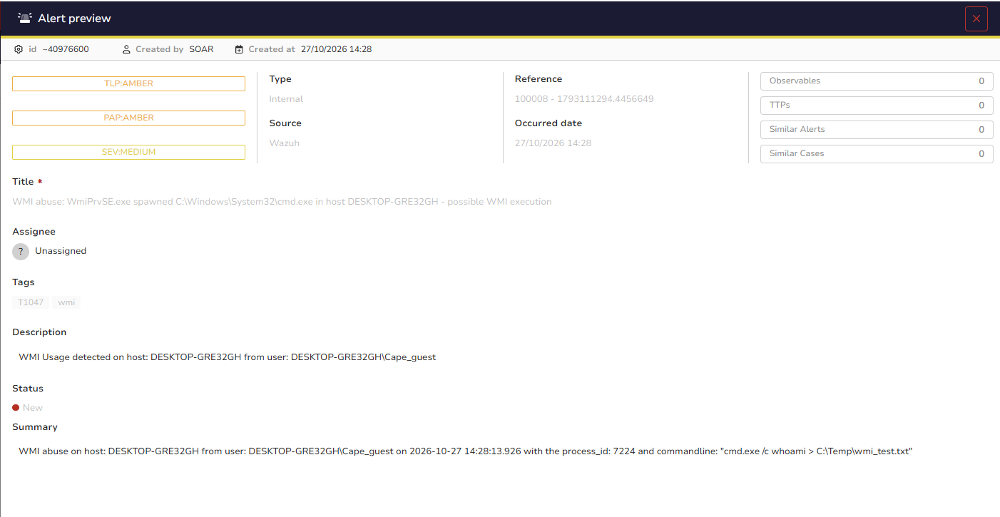

# WMI Abuse — Detection & Response

## Overview

Windows Management Instrumentation (WMI) is a built-in management framework often abused for remote code execution and lateral movement. Remote execution via WMI appears in Sysmon Event ID 1 as a process whose parent is `WmiPrvSE.exe`.

- Technique: MITRE ATT&CK **T1047** (Windows Management Instrumentation)
- Rule IDs: **100007–100008**
- Workflow: Workflow D — enrich → case → notify

## Detection Rule

The event is first decoded by built-in level-0 rules, so the custom rules chain to them with `if_sid` and raise the level.

```xml
<group name="wmi_abuse,">

  <!-- wmic.exe used to create a process or execute on a remote node -->
  <rule id="100007" level="12">
    <if_sid>92068</if_sid>
    <field name="win.eventdata.originalFileName" type="pcre2">(?i)wmic\.exe</field>
    <field name="win.eventdata.commandLine" type="pcre2">(?i)process\s+call\s+create|/node:</field>
    <description>WMI Abuse: wmic.exe usage in host $(win.system.computer) by $(win.eventdata.user): $(win.eventdata.commandLine)</description>
    <mitre><id>T1047</id></mitre>
  </rule>

  <!-- WmiPrvSE.exe spawning a command interpreter (remote WMI execution) -->
  <rule id="100008" level="12">
    <if_sid>92069, 92070</if_sid>
    <field name="win.eventdata.parentImage" type="pcre2">(?i)wmiprvse\.exe$</field>
    <field name="win.eventdata.image" type="pcre2">(?i)(cmd|powershell|pwsh|wscript|cscript|mshta|rundll32)\.exe$</field>
    <description>WMI abuse: WmiPrvSE.exe spawned $(win.eventdata.image) in host $(win.system.computer) - possible WMI execution</description>
    <mitre><id>T1047</id></mitre>
  </rule>

</group>
```

Rule 100007 catches direct `wmic.exe process call create` / `/node:` usage; rule 100008 catches the downstream sign — a command interpreter whose parent is `WmiPrvSE.exe`.

## Triggering the Alert

`wmic` has been removed from recent Windows 11 builds, so rule 100007 cannot be triggered there. Rule 100008 is the core detection and fires via `Invoke-WmiMethod`, which spawns the new process under `WmiPrvSE.exe`:

```powershell
Invoke-WmiMethod -Class Win32_Process -Name Create -ArgumentList "cmd.exe /c whoami > C:\Temp\wmi_test.txt"
```



## SOAR Workflow (Shuffle) — Workflow D

Trigger: rules 100007/100008 forwarded to a Shuffle webhook (`<rule_id>100007,100008</rule_id>`).

Flow: **webhook → extract process hash → VirusTotal hash report → create TheHive alert → email.**

- A **Regex** node extracts the SHA256 of the spawned process from `win.eventdata.hashes`.
- **VirusTotal — Get a hash report**. For standard interpreters (cmd/powershell) the hash is a signed system binary and comes back clean; the VirusTotal step still catches a renamed or unsigned binary. The real value of this case is the context recorded in the case (host, user, parent, command line).
- **TheHive — Create alert** records host, user, parent (`WmiPrvSE.exe`), child image and the command line, plus the VirusTotal verdict. The command line is Liquid-escaped (backslashes first, then quotes).
- **Email** notifies the analyst.




## Result


